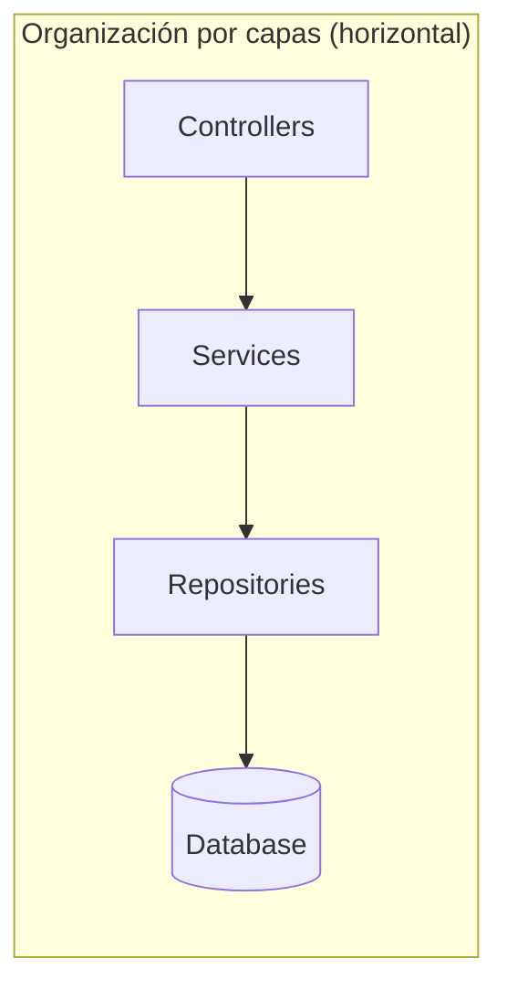
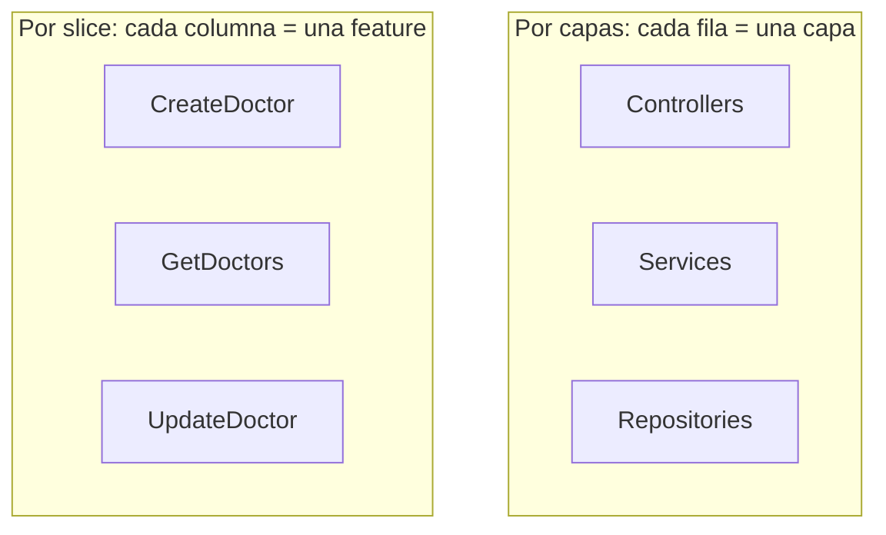

# Vertical Slice Architecture

> Cómo organizar el código por **casos de uso (features)** en vez de por **capas técnicas**,
> aplicado al módulo de **Doctores** de Medinet.

---

## 1. El problema: arquitectura por capas

En la arquitectura tradicional "en capas" agrupamos el código por su **rol técnico**:



Problemas típicos:

- **Cambiar una sola feature toca muchas carpetas** (Controller + Service + Repository + DTOs…).
- **Alto acoplamiento**: los servicios tienden a crecer y mezclan responsabilidades.
- Las capas se vuelven genéricas ("DoctorService" con 20 métodos) y difíciles de mantener.

En un sistema con **MediatR + FluentValidation** estas capas genéricas sobran.

---

## 2. La idea: Vertical Slice Architecture (VSA)

VSA propone organizar el código por **feature / caso de uso**. Cada *slice* (rebanada) es
**vertical**: atraviesa todas las capas que necesita (endpoint, validación, lógica, acceso a datos)
y es autocontenida.


Comparado con las capas horizontales, la **diferencia clave** es el **eje de agrupación**:



**Regla mental:** *"Un cambio de negocio = un lugar del código."*

---

## 3. Anatomía de una slice

Cada caso de uso agrupa todo lo que necesita. En Medinet usamos:

| Pieza | Rol | Tecnología |
|---|---|---|
| **Endpoint** | Expone el caso de uso | Minimal API (`IEndpointRouteBuilder`) |
| **Request/Command/Query** | Entrada al caso de uso | MediatR (`IRequest<T>`) |
| **Validator** | Reglas de entrada | FluentValidation |
| **Handler** | Orquesta la lógica | MediatR (`IRequestHandler`) |
| **Response (DTO)** | Salida | `record` |

El **dominio** (`Doctor`, `Person`) y la **persistencia** (`AppDbContext`, configuraciones EF)
son **compartidos por el módulo**, no por cada slice. Solo la lógica del caso de uso se aísla.

---

## 4. Estructura de carpetas en Medinet (Doctors)

```
Api/Modules/Doctors/
├── Domain/
│   └── Doctor.cs                         # Entidad compartida del módulo
├── Infrastructure/
│   └── Persistence/
│       └── DoctorConfiguration.cs        # Mapeo EF (IEntityTypeConfiguration)
└── Application/
    └── Features/
        ├── CreateDoctor/
        │   ├── CreateDoctorCommand.cs    # Request (MediatR)
        │   ├── CreateDoctorValidator.cs  # Validación (FluentValidation)
        │   ├── CreateDoctorHandler.cs    # Lógica del caso de uso
        │   ├── CreateDoctorResponse.cs   # DTO de salida
        │   └── CreateDoctorEndpoint.cs   # Endpoint HTTP
        ├── GetDoctors/
        │   ├── GetDoctorsQuery.cs
        │   ├── GetDoctorsHandler.cs
        │   ├── GetDoctorsResponse.cs
        │   └── GetDoctorsEndpoint.cs
        └── GetDoctorById/
            ├── GetDoctorByIdQuery.cs
            ├── GetDoctorByIdHandler.cs
            ├── GetDoctorByIdResponse.cs
            └── GetDoctorByIdEndpoint.cs
```

Cada carpeta de feature tiene **todo lo suyo adentro**. Si mañana se borra "GetDoctorById",
se borra su carpeta completa y no queda código huérfano en ningún "servicio".

---

## 5. CQRS con MediatR

VSA se combina naturalmente con **CQRS** ligero (usando MediatR):

- **Command** → escribe (CreateDoctor, UpdateDoctor, DeleteDoctor). Devuelve `IRequest<T>`.
- **Query** → lee (GetDoctors, GetDoctorById). Nunca modifica estado.

No hace falta infraestructura de CQRS completa (event sourcing, dos bases de datos).
Es solo separar **lecturas** de **escrituras** a nivel de casos de uso.

### Pipeline de validación (una sola vez, compartido)

```csharp
using FluentValidation;
using MediatR;

public class ValidationBehavior<TRequest, TResponse> : IPipelineBehavior<TRequest, TResponse>
    where TRequest : notnull
{
    private readonly IEnumerable<IValidator<TRequest>> _validators;

    public ValidationBehavior(IEnumerable<IValidator<TRequest>> validators)
        => _validators = validators;

    public async Task<TResponse> Handle(
        TRequest request,
        RequestHandlerDelegate<TResponse> next,
        CancellationToken cancellationToken)
    {
        if (!_validators.Any())
            return await next();

        var context = new ValidationContext<TRequest>(request);
        var failures = _validators
            .Select(v => v.Validate(context))
            .SelectMany(r => r.Errors)
            .Where(f => f is not null)
            .ToList();

        if (failures.Count != 0)
            throw new ValidationException(failures);

        return await next();
    }
}
```

```csharp
// Registro en Program.cs / SharedServices
builder.Services.AddMediatR(cfg =>
{
    cfg.RegisterServicesFromAssembly(typeof(Program).Assembly);
    cfg.AddOpenBehavior(typeof(ValidationBehavior<,>));
});

builder.Services.AddValidatorsFromAssembly(typeof(Program).Assembly);
```

---

## 6. ¿Qué es MediatR?

**MediatR** es una librería que implementa el *patrón Mediator* dentro del proceso:
tú mandas un **mensaje** (un Command o Query) y MediatR se encarga de **encontrar y
ejecutar su Handler**. El que envía no conoce al que maneja.

### Cómo encaja en VSA

En tus slices tienes dos piezas que MediatR conecta:

```csharp
public record CreateDoctorCommand(...) : IRequest<CreateDoctorResponse>;  // el mensaje

public class CreateDoctorHandler : IRequestHandler<CreateDoctorCommand, CreateDoctorResponse>
{ ... }                                                                    // el manejo
```

El endpoint **no hace `new CreateDoctorHandler()`**; simplemente envía:

```csharp
await sender.Send(command, cancellationToken);   // MediatR busca el handler correcto
```

`ISender` recibe cualquier request y la rutea al `IRequestHandler<CreateDoctorCommand, ...>`
correspondiente por convención de tipos.

### Para qué se usa

1. **Desacoplar** el endpoint de la lógica: el endpoint solo arma el mensaje y lo despacha.
2. **Un handler por caso de uso**: encaja perfecto con VSA (sin "servicios" genéricos).
3. **Pipeline behaviors** — lo más valioso. Son "middlewares" que se ejecutan **alrededor de
   todo handler**: `ValidationBehavior` (corre FluentValidation antes de la lógica),
   `LoggingBehavior`, `TransactionBehavior`, `CachingBehavior`… Se escribe una vez y aplica
   a todos los slices.
4. **Notificaciones / eventos** (`INotification` + `IPublish`): publicar un evento a varios
   suscriptores (ej. "DoctorCreated" → notificar, auditar, etc.).

### En resumen

MediatR es el **"conmutador"** que conecta *mensajes* con *handlers* y da una capa donde meter
validación/logging/transacciones sin repetir código. **No es obligatorio** — podrías inyectar
el handler directo — pero en VSA+CQRS es lo que mantiene los endpoints delgados y las slices
aisladas.

---

## 7. Ventajas y desventajas

### Ventajas

- **Cambios localizados**: una feature = una carpeta.
- **Bajo acoplamiento** entre casos de uso.
- **Fácil de borrar/extender** features.
- **Escala bien en equipos**: varias personas tocan features distintas sin chocar.
- **Testeo por caso de uso** (test de integración por slice).

### Desventajas

- Puede haber **duplicación** de lógica pequeña entre slices (aceptable: se optimiza cada caso).
- Requiere **disciplina** en las convenciones (carpetas, nombres, registro de endpoints).
- Sin una buena abstracción, el registro de endpoints puede volverse repetitivo.
